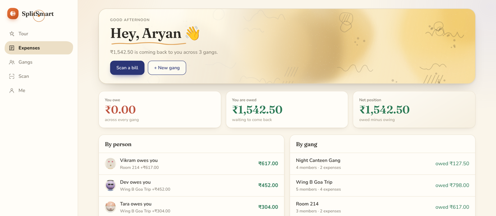

<div align="center">

# SplitSmart

**Scan a receipt, give each item to the people who actually shared it,
and settle up with the fewest payments.**

[**Click here to open the app**](https://nothing4601.github.io/splitsmart/)

[](https://nothing4601.github.io/splitsmart/)




</div>

---

Everything runs on your device. The receipt is read there, speech is transcribed
there, and your groups and expenses are stored there. The only thing that ever
leaves is a group you choose to share — and that goes end-to-end encrypted.

A new install starts completely empty. No sample groups, no sample expenses,
everything at zero.

## What it does

### Splitting a bill

| | |
|---|---|
| **Scan** | Photograph or upload a receipt — or a whole trip's worth at once. Tesseract reads it on your device, and anything it was unsure of is highlighted for you to check. |
| **Parse** | Items, quantities, unit prices and line totals, plus subtotal, CGST/SGST, service charge, discount and grand total. Addresses, GSTIN numbers and footer noise are dropped. |
| **Check** | Every field is editable, lines can be added or deleted, and the photo sits beside the table. If the lines don't reach the printed total, it says so and shows the difference. |
| **Assign** | Tap people onto each line. Shared items split between their assignees; tax and service are spread in proportion to what each person actually ate, not per head. |
| **Or just split it** | Equal, exact amounts, percentages or shares — with the input validated as you go. |

### Getting your money back

| | |
|---|---|
| **Balances** | Each member's net position, recomputed on every change. |
| **Settle up** | The *exact minimum* number of payments, with a UPI deep link and QR code for each, and one tap to mark it done. |
| **Across groups** | One dashboard nets what you owe and are owed over every group, matched by person. |
| **Analytics** | Spending by category, by member, by group and by month. |

### Nice to have

**Say it** — describe an expense out loud (*"Dev paid 600 for pizza, split equally"*);
Whisper runs in your browser and drafts it. On a scanned bill you can also *say who
had what* (*"I had the vada, the rest between the others"*).
**Sync** — share a group by link or file and two phones stay in step, end-to-end
encrypted through a public relay; no account, no server.
**Recurring** — monthly things like a Wi-Fi recharge add themselves.
**Export** — settlement summary as PDF, expenses as CSV, the group as JSON.
**Characters** — a three.js lobby stands in for avatars: pick one of twelve, or mix
and match your own.
**Offline** — installable as a PWA, and every byte it needs ships with the site.

## How it's built

- **One file.** The whole app is `index.html` — CSS, markup and script inline. No
  bundler, no framework, no backend, nothing to install.
- **Money is never a float.** Integer paise from parsing through to settle-up. A
  documented largest-remainder rule hands out the odd paisa, so ₹100 three ways is
  33.34 + 33.33 + 33.33 and the parts always rebuild the whole.
- **Fewest payments, properly.** Settlement is an exact minimum found by dynamic
  programming, not the usual greedy approximation.
- **Tested, not trusted.** A DOM-free `split-logic` block holds the allocation,
  shares, balances, settle-up and the receipt and speech parsers. The tests pull that
  block straight out of the HTML and run it in a sandbox.
- **Nothing heavy on first paint.** OCR, the category model and Whisper are fetched
  only when you first use them. three.js is vendored, so neither the first screen nor
  offline use depends on a CDN.

## Run it

```bash
python3 -m http.server      # then open http://localhost:8000
node --test                 # 38 unit tests for the money and parsing logic
```

## Layout

```
index.html              the whole app — CSS, markup and script inline
vendor/                 three.js r147 + OrbitControls + RoomEnvironment
assets/brand/           the 3s intro film
icons/ manifest.webmanifest sw.js    PWA shell
test/logic.test.mjs     unit tests for the money and parsing logic
```
